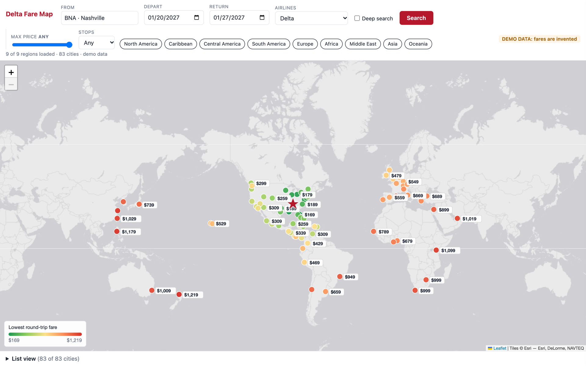
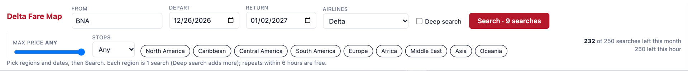

# Delta Fare Map

**See where Delta can fly you from your home airport, and for how much, on one world map.**

Enter a home airport and travel dates. Delta Fare Map shows every city Delta (with its partners)
flies to, each marked with its lowest round-trip fare. Click a city to see the route and choose
real outbound and return flights. Then open the trip in Google Flights or delta.com to book.



It runs on your own computer as a small local web app. Fares come from Google Flights through
[SerpApi](https://serpapi.com). SerpApi's free plan covers casual use, and the app is careful with
it: it caches results, shows the cost of every search before you run it, and warns you when
searches run low.

> **Not affiliated with Delta Air Lines, Google, or SerpApi.** "Delta" is a trademark of Delta Air
> Lines, Inc. Fares are for information only and change constantly. Always confirm the price on
> delta.com or Google Flights before you book.

## Features

- **World fare map.** Every Delta-reachable city for your dates, colored from cheapest (green) to
  most expensive (red). Prices are labeled on the map.
- **Region-by-region search.** Search only the parts of the world you care about. Each region
  costs one SerpApi search.
- **Deep search.** A region search returns only Google's top 30–50 cities, so big regions hide
  airports such as Alaska, Iceland, smaller Indian cities, and Australia or New Zealand beyond
  Sydney and Auckland. Deep search adds smaller areas within each selected region (1 search each)
  to find the rest.
- **Delta or the whole SkyTeam alliance.** Show only flights sold as Delta, or every airport served
  by any SkyTeam airline (Air France, KLM, Korean Air, Aeroméxico, Virgin Atlantic and others).
- **Filters.** Set a maximum price, nonstop or at most one stop, and which regions to show. Filters
  never use a search.
- **Sortable list view.** Every destination in a table, sortable by city, fare, stops, travel time
  or region.
- **Flight drill-down.** Click a city to see outbound flights, pick one to see matching returns,
  and watch the routes drawn on the map as great-circle arcs.
- **Main Cabin, not just Basic.** Google's lowest prices are often Basic Economy. The app finds
  the real Main Cabin fare: automatically for US domestic trips, and with one click for
  international ones.
- **Booking links.** One click opens the trip in Google Flights, or opens delta.com.
- **Careful with your quota.** It shows the searches left on your SerpApi account, the cost of
  each search before you run it, and caches results (6 hours for the map, 1 hour for flights). It
  asks before searching when you're low and stops before you go over.
- **Demo mode.** Try the whole interface with invented fares, no API key needed.

## Quick start

### 1. Install the tools

You need **Python 3.12 or newer** and **[uv](https://docs.astral.sh/uv/)**, a fast Python package
manager. On macOS with Homebrew:

```bash
brew install uv
```

On any other system, use the official installer, or see
[uv's install guide](https://docs.astral.sh/uv/getting-started/installation/):

```bash
curl -LsSf https://astral.sh/uv/install.sh | sh
```

uv downloads a suitable Python for you if your computer doesn't have one.

### 2. Get the code

Clone the repository, or download it as a ZIP and unzip it, then open a terminal in the folder:

```bash
git clone https://github.com/BennettLandman/DeltaWorldFareMap.git
```

```bash
cd DeltaWorldFareMap
```

### 3. Try it with demo data (optional, no key needed)

```bash
DELTAMAP_PROVIDER=demo uv run uvicorn app:app --port 8000
```

Open **http://localhost:8000** and press **Search**. Every fare in demo mode is invented, and the
header says so. Press `Ctrl+C` in the terminal to stop the app.

### 4. Get a SerpApi key and install it

See [Getting a SerpApi API key](#getting-a-serpapi-api-key) and
[Installing the key](#installing-the-key) below. It takes about two minutes.

### 5. Start the app

```bash
uv run uvicorn app:app --port 8000
```

Open **http://localhost:8000**. The first run installs the dependencies into a local `.venv`
folder. Press `Ctrl+C` in the terminal to stop the app.

New to the app? Read the **[User manual](docs/USER_MANUAL.md)**. It walks through every screen
with screenshots.

## Getting a SerpApi API key

Delta Fare Map reads Google Flights data through **SerpApi** (serpapi.com). You need your own
SerpApi key. The free plan is enough for personal use: at the time of writing it includes
**250 searches a month**. See [serpapi.com/pricing](https://serpapi.com/pricing) for current plans.

1. Go to **https://serpapi.com/users/sign_up** and create a free account.
2. Verify your email address. SerpApi may also ask you to verify a phone number before the key
   works.
3. Open **https://serpapi.com/manage-api-key**.
4. Copy the long string labeled **Your Private API Key**.

> **Use serpapi.com, not a similarly named service.** Keys from other search-API companies, such
> as searchapi.io, will not work. When the app starts with the wrong kind of key, it says
> "Invalid API key" and falls back to demo data.

Keep the key private. Anyone who has it can use up your searches. If it leaks, generate a new one
on the same page.

## Installing the key

Choose **one** of these. The app checks them in this order: the environment variable, then
`.env`, then the key file.

**Option A: a key file (simplest).** Create a file named `serpapi.key` in the project folder,
next to `app.py`, containing only the key:

```bash
echo "paste-your-key-here" > serpapi.key
```

**Option B: a `.env` file.** Copy the example settings file and fill in `SERPAPI_KEY`:

```bash
cp .env.example .env
```

```ini
SERPAPI_KEY=paste-your-key-here
```

**Option C: an environment variable**, set in the same terminal before starting the app:

```bash
export SERPAPI_KEY=paste-your-key-here
```

`serpapi.key`, `.env` and every `*.key` file are listed in `.gitignore`, so git will not commit
your key.

**Check that it worked.** Start (or restart) the app. The top-right corner of the page should show
something like **"232 of 250 searches left this month"**:



This check uses SerpApi's free Account API, so it never uses a search. If the corner says
**"DEMO DATA"** instead, hover over it, or read the line below it, to see why. The usual causes are
no key found, a typo in the key, or a key from another service.

## What uses a search

Every SerpApi search counts against your monthly allowance. The app shows each search's cost
before you run it, and it never searches when you only filter, sort, or re-open something cached.

| Action | Searches |
|---|---|
| Map search | 1 per selected region (up to 9). Regions already cached for that airport, those dates and that airline network (6 hours) cost 0. |
| Deep search | 1 more per smaller area in each selected region (up to 37 more; 46 for the whole world). Europe alone is 1 + 6. |
| Turn on another region after a search | 1 |
| Open a city | 1 (cached for 1 hour) |
| Pick an outbound flight, which loads the returns | 1 (cached for 1 hour) |
| "Find Main Cabin fare" (international) | up to 2 |
| "Check fare names" (international) | 1 |
| Filters, list view, sorting, re-opening a cached city | 0 |
| The searches-left meter and the cost shown on the Search button | 0 |

A full world search, plus a closer look at a few cities, costs about 15 searches. A deep search
of the whole world costs 46. Searching only the regions you care about makes the free plan go much
further: for example, a deep search of just Europe and Oceania costs 7 + 5 = 12.

**Guardrails.** The app asks before any single search action that uses more than 10 searches
(`BIG_SEARCH_WARN`). When fewer than 20 searches are left (`LOW_QUOTA_WARN`), it asks before every
search. If a search would exceed your monthly or hourly limit, the app blocks it and shows only
cached results. SerpApi does not charge for requests it rejects.

## Settings

All settings are optional. Put them in `.env`, or set them as environment variables.

| Setting | Default | What it does |
|---|---|---|
| `SERPAPI_KEY` | none | Your SerpApi key. Alternatively, use a `serpapi.key` file. |
| `DELTAMAP_PROVIDER` | `serpapi` if a key is found, otherwise `demo` | Set to `demo` to use invented fares, even when you have a key. |
| `AIRLINE_FILTER` | `DL` | The starting choice in the **Airlines** menu. `DL` gives flights sold as Delta, including Delta codeshares on Air France, KLM and other partners. `SKYTEAM` gives every SkyTeam airline, including partner-only routes. You can switch in the page at any time. |
| `LOW_QUOTA_WARN` | `20` | Below this many searches left, the app asks before each search. |
| `BIG_SEARCH_WARN` | `10` | The app asks before any search that uses more than this many searches, such as a deep search. |

The default home airport (BNA), the cache times (6 hours for the map, 1 hour for flights), and the
regions and deep-search areas are set in [`deltamap/config.py`](deltamap/config.py).

## Troubleshooting

**"address already in use" when starting.** Something else is using port 8000, perhaps another
copy of the app. Stop it, or start this copy on another port:

```bash
uv run uvicorn app:app --port 8001
```

**The header says "DEMO DATA" but I installed a key.** Restart the app after adding the key; it
reads the key only at startup. Check that the file is named exactly `serpapi.key`, sits in the
project folder, and contains only the key. The reason the key was rejected appears under
"DEMO DATA" in the header.

**The map is blank or gray.** The map tiles (Esri) and the map library (Leaflet) load from the
internet, so check your connection.

**A region shows an error after searching.** The error text appears in the status line. A region
that fails costs nothing, unless SerpApi actually ran the search. Search again later; regions
that worked stay cached.

**I don't see cities I know Delta serves (Alaska, Iceland, India, Australia…).** A region search
returns only Google's top 30–50 priced cities, so turn on **Deep search** for that region. Cities
reachable only on partner airlines appear when **Airlines** is set to **SkyTeam**. Seasonal routes,
such as Iceland in winter, appear only for dates when they operate. Asia and Australia may also
be drawn on the copy of the world west of the Pacific, because the map centers on your home
airport.

**"No Delta destinations found for these dates."** The dates may be too far out, or too soon, for
Google to have fares. Try dates two to ten months ahead.

**I want to clear the cache.** Stop the app and delete `cache.sqlite3`. The app creates a new one.
Your next searches will then use searches again.

## How it works

The browser page talks only to the local server. The local server calls SerpApi, caches every
answer in a local SQLite file (`cache.sqlite3`), and streams the map results back region by region.

```
Browser (Leaflet map) ⇄ local FastAPI server ⇄ SerpApi ⇄ Google Travel Explore / Google Flights
                               │
                        cache.sqlite3 (cached results, log of searches, confirmed Main fares)
```

- **The map** uses SerpApi's *Google Travel Explore* engine: one call per region (plus one per
  smaller area with Deep search), filtered to Delta or SkyTeam.
- **City details** use the *Google Flights* engine. Returns use the outbound flight's
  `departure_token`. Fare names (Main Basic, Main Classic…) use the trip's `booking_token`.

[docs/HOW_IT_WORKS.md](docs/HOW_IT_WORKS.md) explains the fare logic, the guardrails and the API
findings behind the design.

## Project layout

```
app.py                  FastAPI server: API routes, map streaming, cache and quota guardrails
deltamap/
  config.py             settings, regions, and where the key is read from
  cache.py              SQLite cache, search log, confirmed Main Cabin fares
  airports.py           airport lookup and autocomplete (airportsdata package, offline)
  providers/
    serpapi.py          live data from SerpApi
    demo.py             invented, deterministic demo data
    base.py             shared data model and parsers
static/                 the web page: index.html, style.css, app.js (Leaflet, no build step)
spike.py                the API experiment that shaped the design (see docs/HOW_IT_WORKS.md)
docs/                   user manual, technical notes, screenshots
```

## Limitations

- Round trips only, for 1 adult in economy, priced in US dollars.
- Fixed dates. There is no "± 3 days" flexible-date search yet.
- Map prices come from Google and are usually Basic Economy until you open a city. See
  [Main Cabin vs Basic](docs/USER_MANUAL.md#main-cabin-vs-basic-economy).
- The delta.com button opens Delta's search page, not a specific itinerary. Delta has no public
  deep link for that.

## License

Copyright 2026 the Delta Fare Map contributors.

Licensed under the [Apache License, Version 2.0](LICENSE). You may not use this project except in
compliance with the License. Unless required by applicable law or agreed to in writing, it is
distributed on an "AS IS" BASIS, WITHOUT WARRANTIES OR CONDITIONS OF ANY KIND.

Map tiles © Esri. Airport data from the
[airportsdata](https://github.com/mborsetti/airportsdata) package. Your use of SerpApi is subject
to [SerpApi's terms](https://serpapi.com/legal).
