# Delta Fare Map: User manual

This guide walks through the app screen by screen. If you haven't installed it yet, start with the
[README](../README.md#quick-start).

The screenshots use the app's built-in **demo data** (`DELTAMAP_PROVIDER=demo`), so every fare in
them is invented. With a real SerpApi key, the screens look the same but show live fares.

**Contents**

1. [The screen at a glance](#1-the-screen-at-a-glance)
2. [Choose your home airport](#2-choose-your-home-airport)
3. [Choose dates, regions, airlines and depth](#3-choose-dates-regions-airlines-and-depth)
4. [Search and read the map](#4-search-and-read-the-map)
5. [Filter the map](#5-filter-the-map)
6. [Use the list view](#6-use-the-list-view)
7. [Look at a city](#7-look-at-a-city)
8. [Pick a return flight](#8-pick-a-return-flight)
9. [Check fare names (international)](#9-check-fare-names-international)
10. [US domestic trips](#10-us-domestic-trips)
11. [Book the trip](#11-book-the-trip)
12. [Main Cabin vs Basic Economy](#main-cabin-vs-basic-economy)
13. [Making your searches last](#making-your-searches-last)
14. [Keyboard and other shortcuts](#keyboard-and-other-shortcuts)

---

## 1. The screen at a glance

Open **http://localhost:8000** after starting the app.

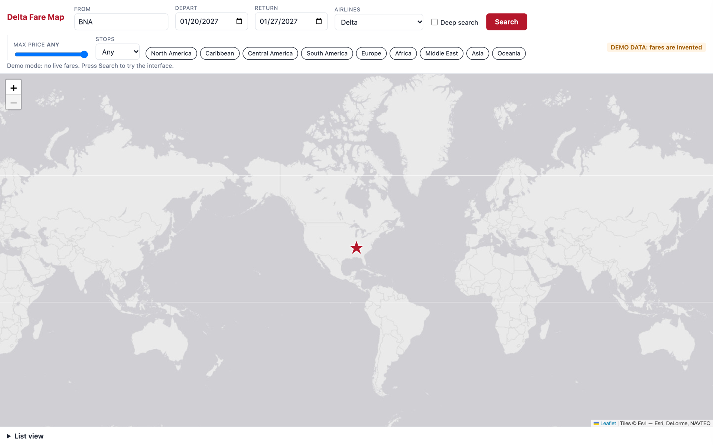

| Part | What it is |
|---|---|
| **From** | Your home airport. Defaults to BNA (Nashville). |
| **Depart / Return** | Your travel dates. They default to 30 days from today, for one week. |
| **Airlines** | *Delta* or *SkyTeam (all partners)*. |
| **Deep search** | Also searches smaller areas inside each region, to find more airports. |
| **Search** | Runs the map search. With a live key, the button shows what the search will cost, such as *Search · 9 searches* or *Search · cached*. |
| **Max price** | A slider that hides cities above a fare. |
| **Stops** | Any, at most 1 stop, or nonstop only. |
| **Region chips** | North America, Caribbean, Central America, South America, Europe, Africa, Middle East, Asia, Oceania. These choose what to search *and* what to show. |
| **Top-right corner** | Searches left on your SerpApi account, or *DEMO DATA* in demo mode. |
| **Status line** | Below the filters. It says what the app is doing and what the last search cost. |
| **Map** | The fare map, with a fare legend in the bottom-left corner. |
| **List view** | Below the map. Click it to open a sortable table of every city. |

## 2. Choose your home airport

Click **From** and type a city name, an airport name, or a three-letter code. Matching airports
appear as you type. Use the mouse, or the arrow keys and **Enter**, to pick one.

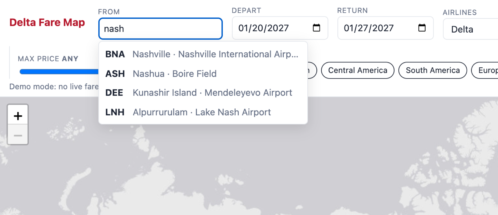

Airport lookup runs entirely on your computer, so it never uses a search. You can also type a code
such as `ATL` directly.

## 3. Choose dates, regions, airlines and depth

Pick a **Depart** and a **Return** date. The return date must be after the departure date, and
the departure date can't be in the past.

Then decide which **regions** to search. Each region chip that is switched on (filled) is searched
when you press Search, and each region costs **one SerpApi search**. Click a chip to switch it on
or off. The app remembers your choice for next time.

With a live key, the **Search** button tells you the cost before you commit, and the top-right
corner shows how many searches you have left:

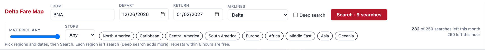

- **Search · 9 searches**: nine regions are selected, and none of them has been searched yet for
  this airport and these dates.
- **Search · 2 searches**: some regions are already cached, so only two need a new search.
- **Search · cached**: everything is cached for 6 hours, so the search is free.

> **Tip:** If you only care about Europe, switch every other chip off before searching. That's 1
> search instead of 9.

### Airlines: Delta or SkyTeam

- **Delta** (the default) shows flights sold as Delta. That includes Delta's codeshares on
  partners such as Air France, KLM and Korean Air.
- **SkyTeam (all partners)** shows every airport served by any SkyTeam airline. That includes
  routes Delta doesn't sell, such as a city only Air France, Aeroméxico or Kenya Airways flies to.
  The list view's **Airline** column and each city's tooltip name the airline.

Each network is searched and cached separately. Switching to SkyTeam therefore costs a new
search, even for regions already cached for Delta.

### Deep search: find more airports

One region search returns only Google's top **30–50 priced cities**, so large regions leave many
airports out. Alaska may show only Anchorage, the Nordic countries may show only the capitals,
and Australia only Sydney and Melbourne.

Tick **Deep search** to also search smaller areas inside each selected region. Hover over a
region chip to see its areas:

| Region | Areas added by Deep search |
|---|---|
| North America | Alaska, Hawaii, Western US, Midwestern US, Southern US, Northeastern US, Canada, Mexico |
| Caribbean | Greater Antilles, Lesser Antilles |
| Central America | none (one search already covers it) |
| South America | Brazil, Argentina, Chile, Colombia, Peru |
| Europe | British Isles, Nordic countries and Iceland, Western, Central, Southern and Eastern Europe |
| Africa | North, West, Central, East and Southern Africa |
| Middle East | Arabian Peninsula, Levant |
| Asia | Japan, China, East Asia, Southeast Asia, South Asia (India) |
| Oceania | Australia, New Zealand, Polynesia, Melanesia |

Each area is **1 search**, on top of the region itself. A region you already searched normally
stays cached, so turning on Deep search later costs only the extra areas. The Search button
shows the total before you commit. Any search over 10 searches asks you to confirm first.

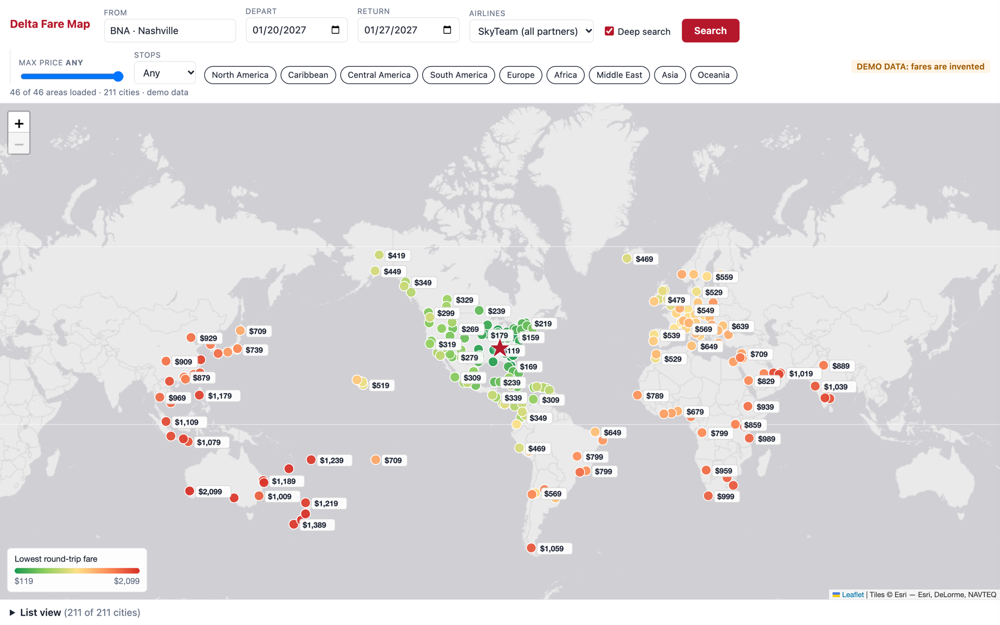

> **Tip:** Deep search is most useful one region at a time. A deep search of Europe is 7
> searches, and of Oceania 5. The whole world is 46.

## 4. Search and read the map

Press **Search**. Regions arrive one at a time, and the status line counts them: *"9 of 9 regions
loaded · 83 cities · uses 9 searches"*. With Deep search it counts areas instead, for example
*"46 of 46 areas loaded"*.

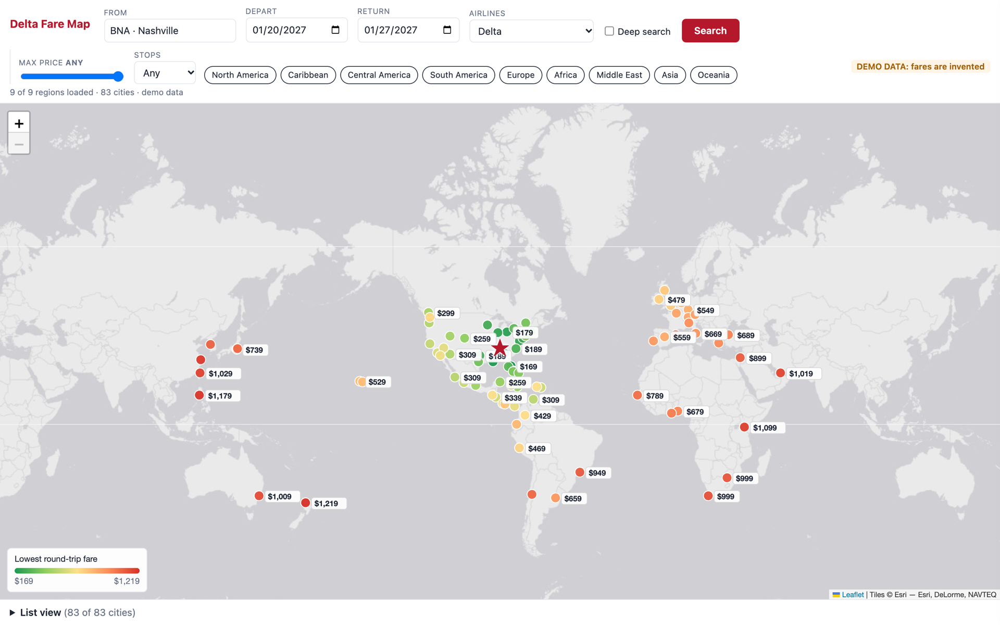

How to read the map:

- **★ Red star**: your home airport. The map centers on it. Places more than halfway around the
  world are drawn on the nearer copy of the map. From the US, for example, Japan, Southeast Asia
  and Australia appear on the left, west of the Pacific.
- **Dots**: destinations. Their color shows the fare: **green is cheapest, red is most
  expensive**. The legend in the bottom-left gives the range.
- **Price labels**: the lowest round-trip fare. Where cities crowd together, some labels are
  hidden to avoid overlaps. Zoom in (scroll, or use **+**) to see more of them, or hover over a dot.
- **Click any dot** to open that city (see [section 7](#7-look-at-a-city)).

Every price is for **one adult, round trip, economy, in US dollars**. It is the cheapest fare
Google found, which is often Basic Economy. See
[Main Cabin vs Basic Economy](#main-cabin-vs-basic-economy).

## 5. Filter the map

Filters work instantly and **never use a search**.

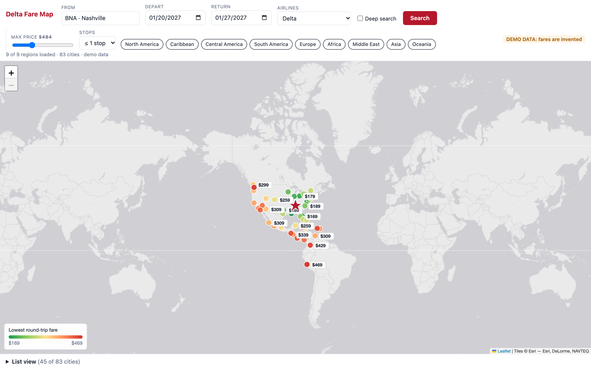

- **Max price**: drag the slider left to hide expensive cities. The label shows the current limit;
  all the way right means *any*. The slider covers the range of fares on the map.
- **Stops**: *≤ 1 stop* or *Nonstop* hides itineraries with more connections.
- **Region chips**: switching a chip off hides that region. Switching a chip on after a search
  loads that region into the map. That costs 1 search, unless the region is cached.

The color scale adjusts to the cities still shown, so you can still tell cheap from expensive
within your budget. The list view's count shows how many cities pass the filters, for example
*(45 of 83 cities)*.

## 6. Use the list view

Click **List view** below the map to open a table of every city that passes your filters.

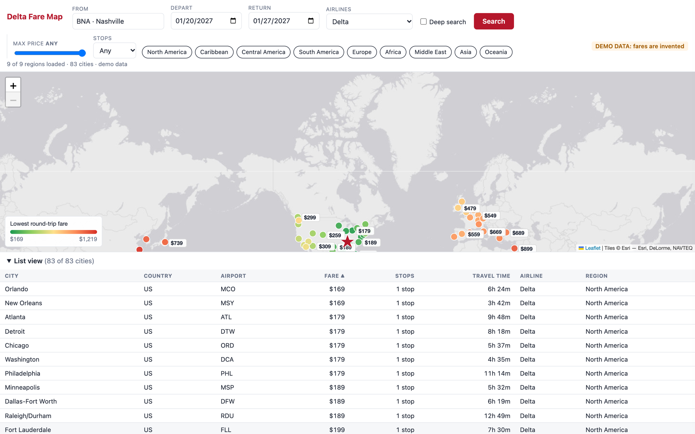

- It starts sorted by fare, **cheapest first**. Click any column heading to sort by it, and click
  the heading again to reverse the order.
- A **✓** after a fare means that fare is a confirmed Main Cabin price.
- **Click a row** to open that city, just like clicking its dot on the map.
- Click **List view** again to close the table.

## 7. Look at a city

Click a city to open its panel on the right. Opening a city costs **1 search**. It is cached for an
hour, so re-opening the city is free.

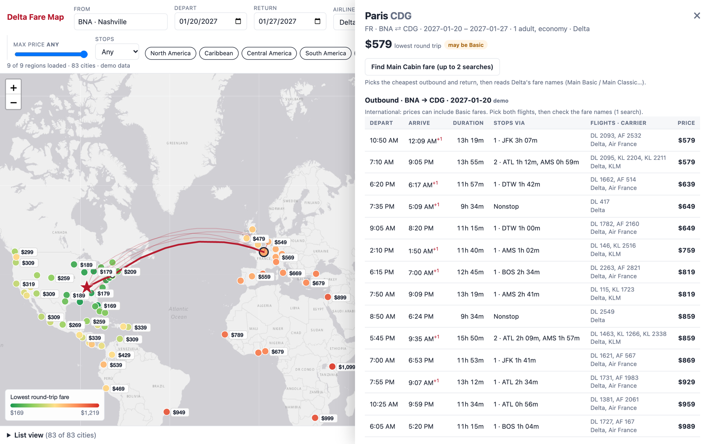

The panel shows:

- **The city, the airport code, the dates and the lowest round-trip fare**, plus a badge:
  - <kbd>may be Basic</kbd>: the price came from the map search and is probably Basic Economy.
  - <kbd>Main Cabin confirmed</kbd>: the price is the lowest Main Cabin (or better) fare found.
- **Find Main Cabin fare (up to 2 searches)**: international cities only. See
  [section 9](#9-check-fare-names-international).
- **Outbound flights**, cheapest first. Each row shows the departure and arrival times (*+1* means
  the next day), the total duration, the stops with their connection times, the flight numbers,
  the airlines and the round-trip price.

On the map, every outbound routing is drawn as a faint red arc. The cheapest, or the one you
selected, is drawn bold. Connection airports show as small white dots.

Close the panel with the **×** button or the **Esc** key.

## 8. Pick a return flight

Click an outbound flight. The app loads the return flights that go with it. That costs **1
search**, cached for an hour.

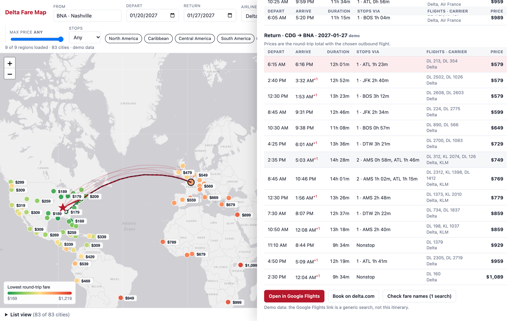

- Return prices are the **round-trip total** with the outbound flight you picked. They are not the
  price of the return leg on its own.
- Click a return flight to select it. It is highlighted in the table and drawn on the map as a
  **dashed dark line**.
- Booking buttons appear below the table (see [section 11](#11-book-the-trip)).

To try a different outbound flight, click another outbound row. That loads its returns, which
costs 1 search unless they are cached.

## 9. Check fare names (international)

For international trips, Google's prices may be Basic Economy, and the flight tables can't tell
you which. Once you've picked both flights, press **Check fare names (1 search)** to see every fare
Delta sells for that exact itinerary:

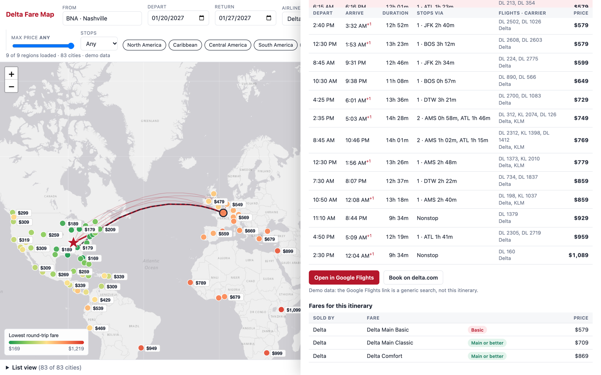

Each fare is marked <kbd>Basic</kbd> or <kbd>Main or better</kbd>. When a Main Cabin fare sold by
Delta is found, it becomes the city's price on the map, marked *Main Cabin confirmed* and with a
✓ in the list view.

**Find Main Cabin fare** (at the top of the panel) does all of this in one click. It picks the
cheapest outbound and the cheapest return, then reads the fare names. That costs up to 2 searches
in total.

## 10. US domestic trips

For trips within the US, the app asks Google to **leave Basic Economy out** when you open the
city. Every flight listed is then Main Cabin or better, and the lowest one replaces the map price
straight away, at no extra cost.

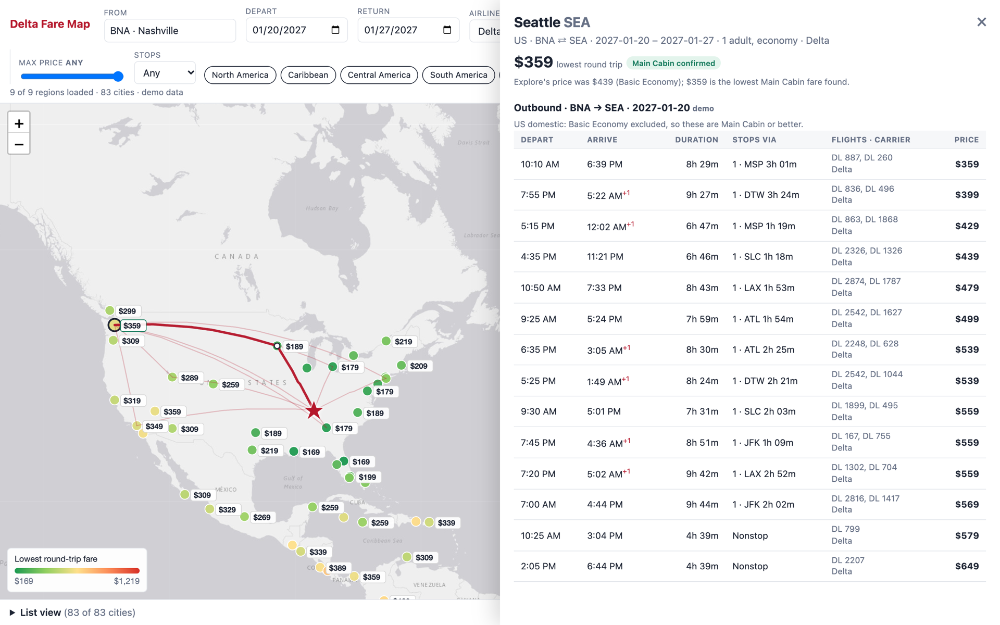

The note under the price shows both fares, for example: *"Explore's price was $439 (Basic
Economy); $359 is the lowest Main Cabin fare found."*

## 11. Book the trip

After you select a return flight:

- **Open in Google Flights** opens Google Flights for this trip. With live data, it opens the
  same search the app used, so you can see the full details and booking options. In demo mode it
  is a generic search.
- **Book on delta.com** opens Delta's flight search. Delta has no public link to a specific
  itinerary, so the note below the button repeats the airports and dates to enter.

Always confirm the price on the booking site. Fares change often, and the app's data can be up to
an hour old.

---

## Main Cabin vs Basic Economy

Delta sells most economy seats in several fare types: **Delta Main Basic** (Basic Economy), **Main
Classic**, **Main Extra**, and the **Comfort** equivalents. Google's lowest prices, which are what
the map shows, are usually Basic Economy. Basic Economy has no changes and no seat choice, and it
boards last.

The app treats map prices as *may be Basic* until it knows better:

| Trip | How the Main Cabin price is found | Extra cost |
|---|---|---|
| US domestic | Opening the city searches with Basic Economy excluded. | none |
| International | **Find Main Cabin fare**, or **Check fare names** after you pick the flights, reads Delta's fare names for the itinerary. | 1–2 searches |

For international trips, the confirmed price is the cheapest Main fare **on the cheapest Basic
itinerary**. That is usually the cheapest Main fare overall, but not always. A different flight
could have a cheaper Main fare. To compare, check other itineraries with **Check fare names**.

Confirmed Main fares are remembered for 6 hours. If you search the same airport and dates again in
that time, the map shows them straight away.

## Making your searches last

SerpApi's free plan includes a fixed number of searches a month. At the time of writing it is 250.
The app helps you spend them well:

- **The searches-left meter** in the top-right corner is always current. Reading it is free.
- **The cost appears up front** on the Search button and the panel buttons, for example
  *"(up to 2 searches)"*.
- **Results are cached**: map regions for 6 hours, and flights, returns and fare names for 1 hour.
  Anything cached is labeled *from cache* and costs nothing.
- **Confirmation when low**: under 20 searches left, the app asks before every search.
- **A hard stop**: if a search would exceed your monthly or hourly limit, the app blocks it rather
  than failing halfway.

Habits that help:

1. **Search only the regions you need.** Europe alone is 1 search, and the whole world is 9.
   Turn on **Deep search** only for the regions where you want every airport.
2. **Settle your dates before searching.** Each new date pair is a new search.
3. **Use filters and the list view freely.** They never cost anything.
4. **Open cities on purpose.** Each new city costs 1 search, and each outbound flight you click
   costs 1 more.
5. **Explore the interface in demo mode first** (`DELTAMAP_PROVIDER=demo`). It costs nothing.

## Keyboard and other shortcuts

| Action | How |
|---|---|
| Pick an airport suggestion | **↑ / ↓**, then **Enter** |
| Close the city panel | **Esc**, or the **×** button |
| Zoom the map | Mouse wheel, trackpad pinch, or the **+ / −** buttons |
| Share or bookmark a search | After a search, the page address holds the airport and dates (for example `?origin=BNA&depart=2027-01-20&ret=2027-01-27`). Opening that address fills in the form. Press Search to run it; cached regions are free. |
